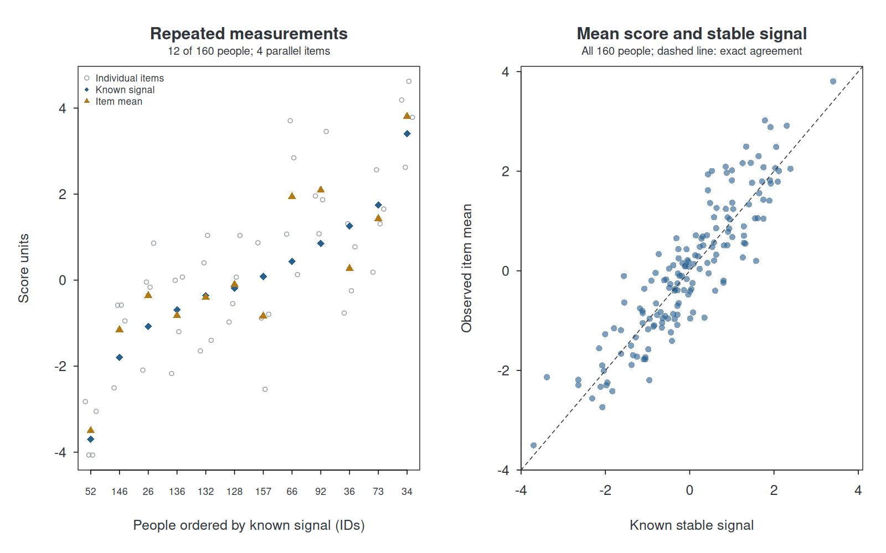
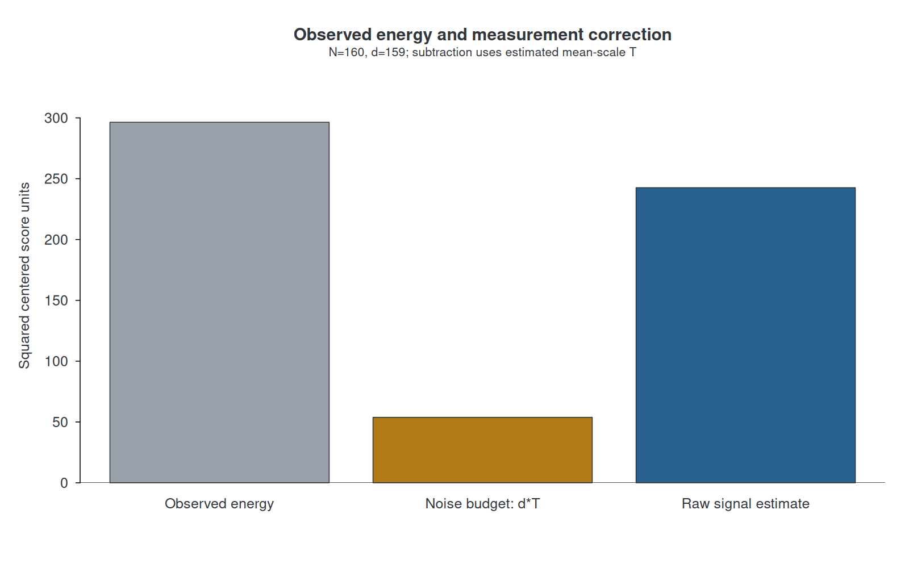
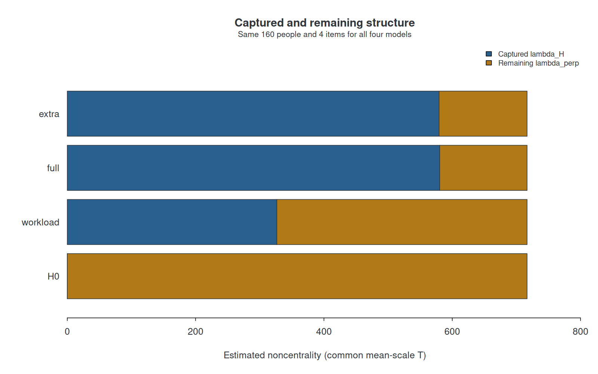
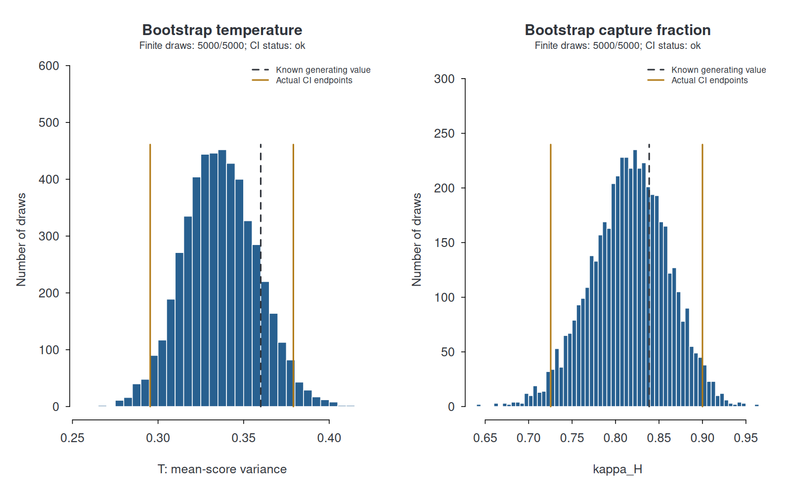
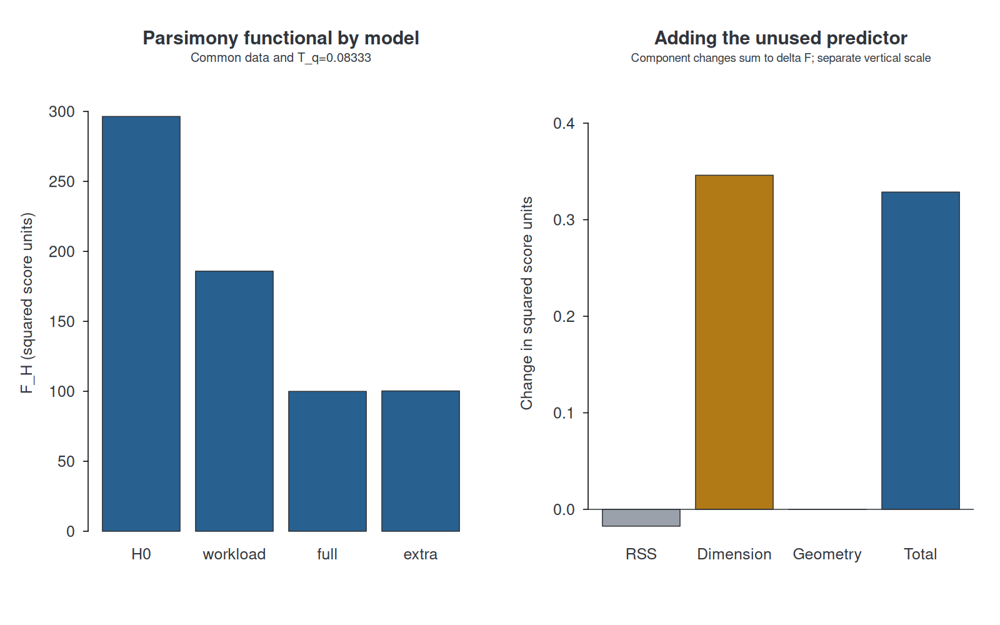
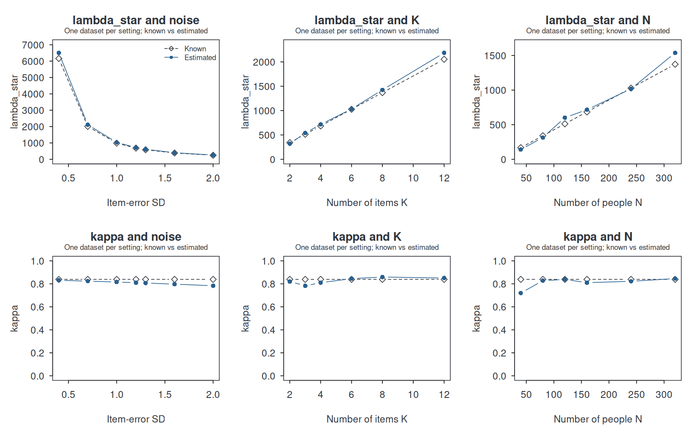
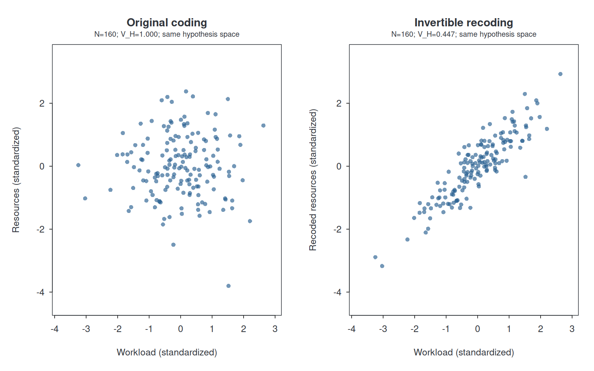

# Learning Lambda Star: your worked example

This is the completed standard lesson (N=160, K=4, B=5000, seed=17).
[Start the executable tutorial](../doc/LEARN_LAMBDASTAR.md) to make predictions,
change settings and obtain live R objects and a saved `lesson.rds`.
The tables, source CSVs and figures below are included with the package.

Synthetic data; Lambda Star estimates use the installed package. Known values come from the explicit generating model.
N=160; K=4; item-error SD=1.2; seed=17; B=5000; confidence level=0.95; T_q=0.0833333.
Estimator: paper. Resampling: whole persons with replacement. Percentiles: type 7.

## 1. Repeated measurements

**Predict before running:** Which differences persist across items, and which fluctuate?

Imagine repeated parallel measurements of wellbeing. Scores are continuous arbitrary units, not a validated questionnaire.
The known stable signal is -0.9*workload + 0.7*resources + 0.5*an unobserved profile. The unused predictor contributes no stable signal.
The profiles are orthogonal with sample variance 1: this controlled construction makes the true contributions inspectable. Each item adds independent normal error.

```r
d <- lesson$example$data
indicators <- lesson$example$indicators
head(d)
```



The mean is less noisy than an individual item, but it still contains measurement error. The latent signal is available here only because we generated the data.

## 2. Estimate the background and total structure

**Predict before running:** Will all between-person variation in the item mean count as stable structure?

```r
measurement <- lambdastar::lambda_measure(d, indicators)
measurement$estimates
```

| parameter | known | estimated |
| --- | --- | --- |
| T (mean-score variance) | 0.360 | 0.338478 |
| lambda_star | 684.583 | 716.716000 |

| component | value |
| --- | --- |
| Observed energy | 296.411 |
| Noise budget d*T | 53.818 |
| Raw signal energy | 242.593 |

On the mean scale, T estimates item-error variance divided by K. Here its generating value is noise_sd^2/K.
With d=N-1, raw signal energy = observed centered energy - d*T, and raw lambda_star = raw signal energy/T. The reported signal estimate is constrained to be nonnegative.
Lambda_star is total stable energy relative to background fluctuation. It is not a percentage or a proportion of explained variance.



## 3. Localize structure in a hypothesis

**Predict before running:** How much should workload capture? What remains after adding resources?

```r
T_q <- lesson$settings$T_q
full <- lambdastar::lambda_model(d, ~workload + resources, indicators, T_q)
full$estimates
```

| model | p | lambda_star | lambda_h | lambda_perp | kappa | true_kappa |
| --- | --- | --- | --- | --- | --- | --- |
| H0 | 0 | 716.716 | 0.000 | 716.716 | 0.000000 | 6.18200e-33 |
| workload | 1 | 716.716 | 326.617 | 390.099 | 0.455714 | 5.22581e-01 |
| full | 2 | 716.716 | 580.496 | 136.220 | 0.809938 | 8.38710e-01 |
| extra | 3 | 716.716 | 579.547 | 137.169 | 0.808615 | 8.38710e-01 |

X_H contains the actual encoded predictor directions. Projection separates observed energy into captured and residual parts.
The paper estimator subtracts p*T from captured energy and (d-p)*T from residual energy. With positive estimated total signal, kappa_H = lambda_H/lambda_star.
Known capture is 52.3% for workload and 83.9% for workload plus resources. The remaining hidden profile is stable structure, not item measurement noise.
H0 contains no hypothesis direction after the intercept is removed. An unused predictor can capture some measurement fluctuation in a particular dataset.
Estimated lambda_H can decrease after adding a direction: the extra noise correction can exceed its gain in observed captured energy.



## 4. Inspect the ordinary percentile bootstrap

**Predict before running:** Which rows travel together when a person is sampled twice?

```r
ix <- lesson$bootstrap$bootstrap$indices[1, ]
d[ix[1:10], c('id', 'workload', 'resources', indicators)]
draws <- lesson$bootstrap$bootstrap$draws
confint(lesson$bootstrap, parm='kappa')
# When all kappa draws are defined (check the diagnostics first):
alpha <- (1-lesson$settings$conf.level)/2
if (all(is.finite(draws[, 'kappa']))) quantile(draws[, 'kappa'], c(alpha, 1-alpha), type=7)
```

| parameter | estimate | lower | upper | n_valid | n_failed | status |
| --- | --- | --- | --- | --- | --- | --- |
| temperature | 0.338478 | 0.295419 | 0.379058 | 5000 | 0 | ok |
| lambda_star | 716.716000 | 519.402000 | 947.618000 | 5000 | 0 | ok |
| lambda_h | 580.496000 | 410.690000 | 794.839000 | 5000 | 0 | ok |
| lambda_perp | 136.220000 | 68.229700 | 203.454000 | 5000 | 0 | ok |
| kappa | 0.809938 | 0.725384 | 0.900016 | 5000 | 0 | ok |

All 5000 draws sample N complete rows with replacement: items and predictors stay together. The selected paper estimator is recalculated each time.
The central 95.0% is bounded by the 2.50% and 97.50% percentiles. This lesson explicitly chooses type-7 interpolation; the package also supports the usual boot interpolation.
No endpoints are widened or replaced. Undefined draws are counted, and an affected regular CI is unavailable; zeros in a defined statistic remain real observations.
A percentile CI describes uncertainty under the chosen row-resampling procedure. One interval containing the known signal is not a coverage validation.



## 5. Compare explicitly coded models

**Predict before running:** Does reducing residual error necessarily reduce F_H?

```r
lambdastar::lambda_compare(d, ~workload, ~workload + resources, indicators, T_q)
```

| model | RSS | dimension | geometry | F_H |
| --- | --- | --- | --- | --- |
| H0 | 296.4110 | 0.000000 | 0 | 296.4110 |
| workload | 185.5190 | 0.346092 | 0 | 185.8650 |
| full | 99.2486 | 0.692183 | 0 | 99.9408 |
| extra | 99.2312 | 1.038280 | 0 | 100.2690 |

| addition | delta_RSS | delta_dimension | delta_geometry | delta_F |
| --- | --- | --- | --- | --- |
| useful | -86.2707000 | 0.346092 | 0 | -85.924600 |
| unused | -0.0174537 | 0.346092 | 0 | 0.328638 |

F_H = RSS + p*Xi_eta(T,T_q) - Xi_a(T,T_q)*log(V_H). The package evaluates Xi_eta numerically; V_H comes from the declared coding of X_H.
The same mean-scale resolution variance T_q=0.0833333 is used for both models in every comparison. It is an explicit illustrative assumption, not estimated from these continuous data.
Adding resources changes F_H by -85.9246; adding the unused predictor changes it by 0.328638. A negative change favors the larger model by this functional; a positive change favors the smaller one.
Extra directions can reduce RSS while adding dimension or geometry costs. An irrelevant predictor can occasionally reduce F_H through sampling fluctuation; a single example does not guarantee model recovery.



## 6. Change the measurement conditions

**Predict before running:** What happens to lambda_star and kappa when noise, K, or N changes?

| experiment | value | n | items | noise_sd | T | true_T | lambda_star | true_lambda_star | kappa | true_kappa |
| --- | --- | --- | --- | --- | --- | --- | --- | --- | --- | --- |
| noise_sd | 0.4 | 160 | 4 | 0.4 | 0.0376087 | 0.0400 | 6505.960 | 6161.250 | 0.830673 | 0.83871 |
| noise_sd | 0.7 | 160 | 4 | 0.7 | 0.1151760 | 0.1225 | 2115.630 | 2011.840 | 0.823617 | 0.83871 |
| noise_sd | 1.0 | 160 | 4 | 1.0 | 0.2350540 | 0.2500 | 1033.520 | 985.800 | 0.815694 | 0.83871 |
| noise_sd | 1.2 | 160 | 4 | 1.2 | 0.3384780 | 0.3600 | 716.716 | 684.583 | 0.809938 | 0.83871 |
| noise_sd | 1.3 | 160 | 4 | 1.3 | 0.3972410 | 0.4225 | 610.379 | 583.314 | 0.806921 | 0.83871 |
| noise_sd | 1.6 | 160 | 4 | 1.6 | 0.6017380 | 0.6400 | 402.624 | 385.078 | 0.797323 | 0.83871 |
| noise_sd | 2.0 | 160 | 4 | 2.0 | 0.9402160 | 1.0000 | 257.856 | 246.450 | 0.783298 | 0.83871 |
| items | 2.0 | 160 | 2 | 1.2 | 0.6852740 | 0.7200 | 321.013 | 342.292 | 0.820430 | 0.83871 |
| items | 3.0 | 160 | 3 | 1.2 | 0.4407830 | 0.4800 | 539.446 | 513.438 | 0.782914 | 0.83871 |
| items | 4.0 | 160 | 4 | 1.2 | 0.3384780 | 0.3600 | 716.716 | 684.583 | 0.809938 | 0.83871 |
| items | 6.0 | 160 | 6 | 1.2 | 0.2426120 | 0.2400 | 1033.090 | 1026.880 | 0.845228 | 0.83871 |
| items | 8.0 | 160 | 8 | 1.2 | 0.1801110 | 0.1800 | 1424.840 | 1369.170 | 0.859162 | 0.83871 |
| items | 12.0 | 160 | 12 | 1.2 | 0.1175760 | 0.1200 | 2185.380 | 2053.750 | 0.850637 | 0.83871 |
| n | 40.0 | 40 | 4 | 1.2 | 0.3237910 | 0.3600 | 141.265 | 167.917 | 0.720096 | 0.83871 |
| n | 80.0 | 80 | 4 | 1.2 | 0.3880450 | 0.3600 | 314.871 | 340.139 | 0.827532 | 0.83871 |
| n | 120.0 | 120 | 4 | 1.2 | 0.3376500 | 0.3600 | 602.005 | 512.361 | 0.838459 | 0.83871 |
| n | 160.0 | 160 | 4 | 1.2 | 0.3384780 | 0.3600 | 716.716 | 684.583 | 0.809938 | 0.83871 |
| n | 240.0 | 240 | 4 | 1.2 | 0.3707570 | 0.3600 | 1018.170 | 1029.030 | 0.822191 | 0.83871 |
| n | 320.0 | 320 | 4 | 1.2 | 0.3491190 | 0.3600 | 1538.160 | 1373.470 | 0.845733 | 0.83871 |

More item noise raises T and reduces the true noncentrality. More independent parallel items lower the noise of their mean and raise noncentrality.
Here Var(S)=1.55 is held exactly fixed by construction. Thus true lambda_star=(N-1)*1.55/T grows with N. The true capture fraction stays 1.30/1.55.
Each point is one dataset, not a simulation average or a confidence band. At fixed N, the seed retains the same profiles and reuses item errors when noise or K changes. Changing N generates a new standardized design.



## 7. Change the coding, preserve the space

**Predict before running:** Will an invertible recoding change captured structure, geometry, or both?

```r
d$resources_tilted <- d$resources + 2*d$workload
lambdastar::lambda_compare(d, ~workload+resources, ~workload+resources_tilted, indicators, T_q)
```

| coding | lambda_h | kappa | RSS | volume | geometry | F_H |
| --- | --- | --- | --- | --- | --- | --- |
| model_a | 580.496 | 0.809938 | 99.2486 | 1.000000 | 0.000000 | 99.9408 |
| model_b | 580.496 | 0.809938 | 99.2486 | 0.447214 | 0.163628 | 100.1040 |

Both codings span the same hypothesis space: their projections, lambda_H and kappa agree. The normalized column volume changes, so the geometry term and F_H can change.
Choose a substantively meaningful coding and report it. A convenient QR basis for projection does not replace the declared model coding in F_H.



## Your next experiment
Change one argument and choose a new output folder. Predict the direction first, then inspect the new tables and plots.
For example: lambdastar_tutorial(output_dir='more-noise', noise_sd=2). Try items=8, n=320, or T_q=1/48 next.
Changing T_q leaves lambda/T/kappa unchanged for the same data, but can change the costs in F_H. Every model comparison still uses one common data matrix and resolution.
The separate ADVANCED_EXAMPLES.md introduces population estimation, common nuisance adjustment and cluster resampling.

